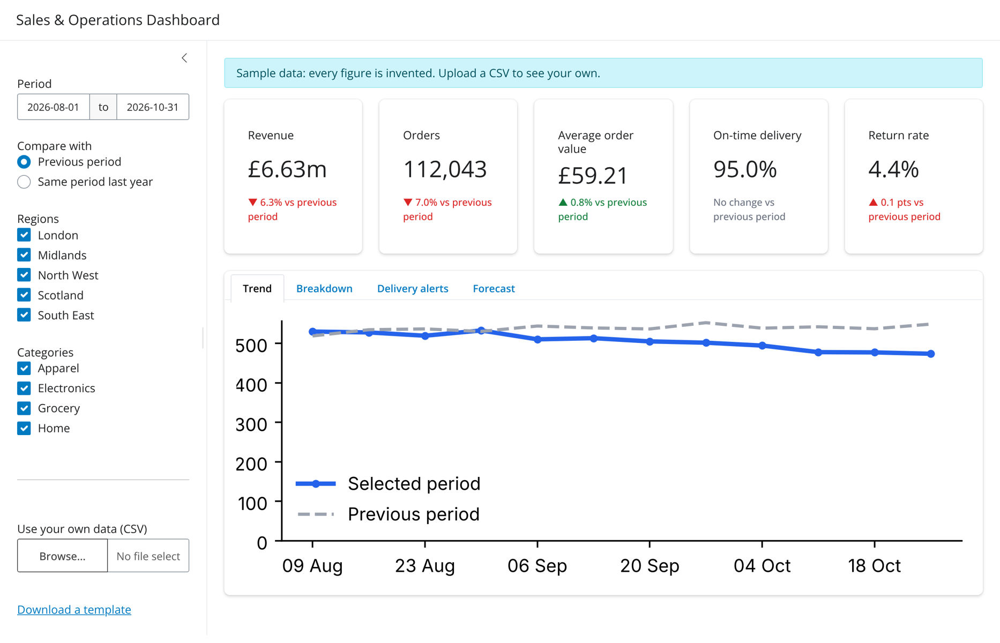
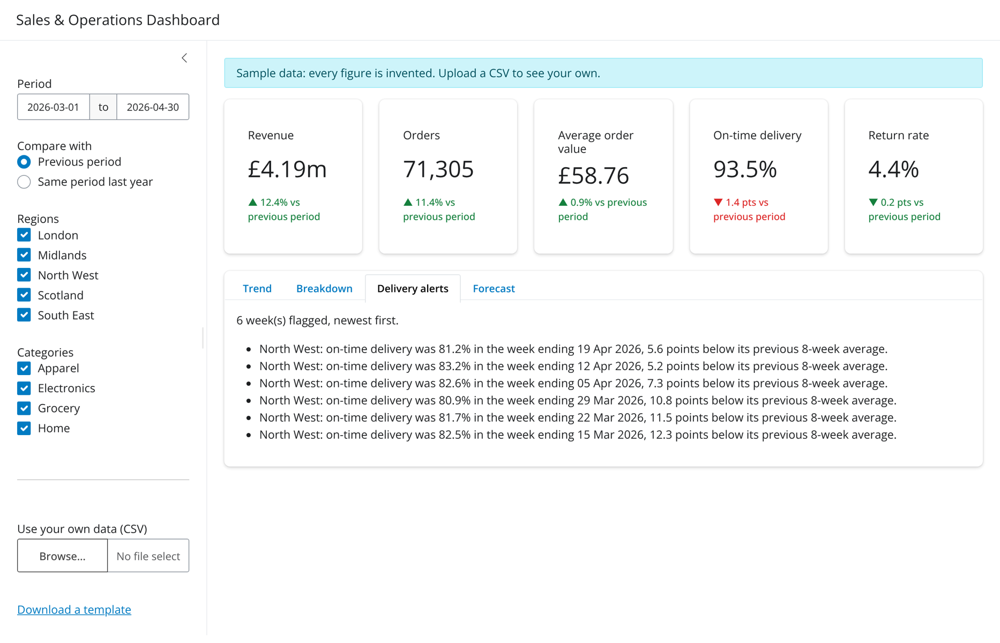
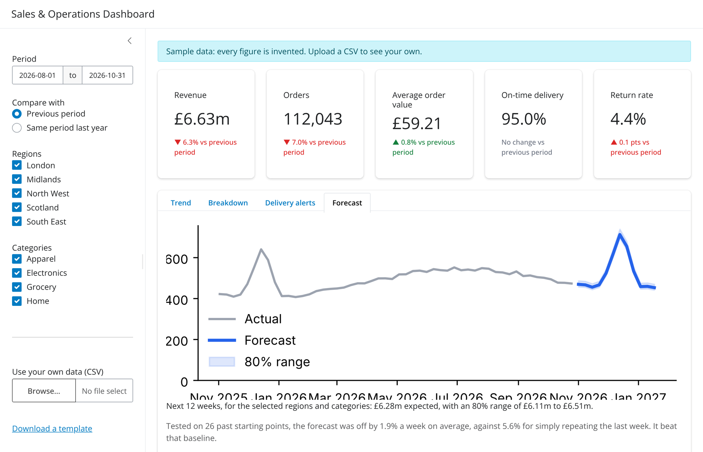

# Sales & Operations Dashboard

[](https://github.com/Niyi-Momoh/sales-ops-dashboard/actions/workflows/deploy.yml)

**[Open the live dashboard](https://niyi-momoh.github.io/sales-ops-dashboard/)**

A Shiny for Python dashboard for commercial and operations teams. It answers the questions those
teams ask every week: how are we doing against last period, where is revenue coming from,
is delivery slipping anywhere, and what should we expect next quarter? Teams can upload their own
CSV, and the whole app runs in the browser, so their data never leaves their computer.



> The bundled data is synthetic. Every figure is invented, including a delivery problem planted
> in the North West in spring 2026 so the alerts have something to find.

## What it does

| Feature | Detail |
|---|---|
| KPI cards | Revenue, orders, average order value, on-time delivery and return rate, each compared with the previous period or the same period last year. Colours show whether a change is good or bad, so a rising return rate is red. |
| Trend | Weekly revenue against the comparison period, using only full Monday-to-Sunday weeks so part-weeks never look like a sudden fall. |
| Breakdown | Revenue, share, growth, on-time and return rates by region or category, with a download of the filtered rows. |
| Delivery alerts | Flags any week where a region's on-time rate fell 5 or more points below its own previous 8-week average, written as plain sentences. |
| Forecast | The next 12 weeks with an 80% range, plus how accurate the method has been on past data compared with a simple benchmark. |
| Your own data | Upload a CSV in the template's format. Problems are explained in plain English, such as which row has an unreadable date, and the dashboard keeps working. |



## Forecast method and accuracy

Each forecast is last year's same 12 weeks, scaled by how much the latest 13 weeks grew compared
with the same 13 weeks a year earlier. To check it honestly, the dashboard repeats the forecast from
26 past starting points using only the data available at each one, then compares it with the real
outcome.

On the sample data, it was off by 1.9% per week on average, compared with 5.6% for simply repeating
the last week. The sample data is regular by design, so real data will be harder to forecast; the
dashboard recalculates both figures for whatever data is loaded and says whether the method beat
the benchmark.



## How it is built and deployed


- **Logic separated from the interface:** all calculations are in `app/logic.py`, which has no Shiny code, so they are tested directly.
- **Serverless deployment:** [Shinylive](https://shiny.posit.co/py/docs/shinylive.html) compiles the app to a static site where Python runs in the browser using WebAssembly. Hosting is free and there is no server to maintain, and uploaded files are processed only on the user's computer.
- **Tested before release:** every push runs 21 unit tests on the calculations, 8 browser tests that click through the running app, and a browser test of the exported site. The site is only deployed if all of them pass.

## Run it locally

```bash
python -m venv .venv && source .venv/bin/activate
pip install -r requirements-dev.txt
python -m playwright install chromium

shiny run app/app.py --reload        # open http://127.0.0.1:8000
pytest                               # unit and browser tests

shinylive export app site            # build the static site
SITE_DIR=site pytest tests/test_static_site.py
```

`python scripts/generate_data.py app/data/sales.csv` recreates the sample data.

## Data format

| Column | Meaning |
|---|---|
| `date` | Day, as YYYY-MM-DD |
| `region`, `category` | Any text labels |
| `orders`, `revenue` | Totals for that day, region and category |
| `on_time_orders`, `returns` | Counts, each no more than `orders` |

## Limitations

- The first visit downloads Python and its libraries into the browser, which is tens of megabytes, so it takes several seconds on a fast connection. Later visits use the browser cache.
- Running in the browser suits up to a few hundred thousand rows. Larger data, live database connections or shared logins would need a hosted Shiny server instead.
- The forecast is a simple seasonal method, and it is not suitable for data with less than about two years of history.
- The previous-period comparison lines up weeks by position, not by calendar date.

Licensed under MIT.
